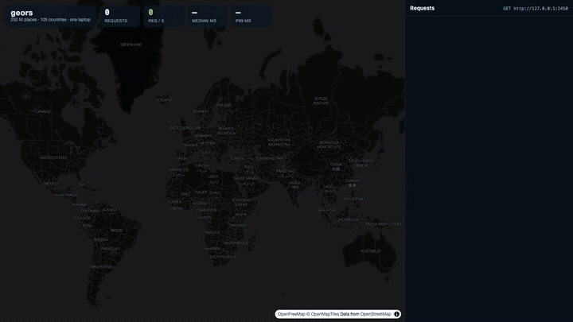
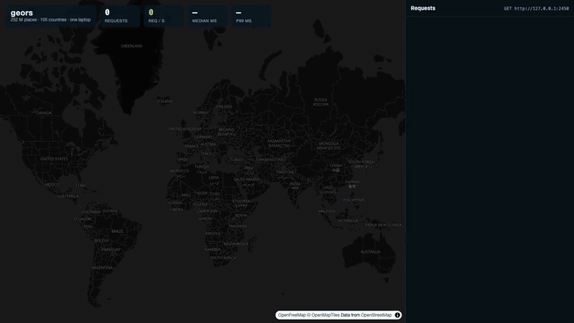

# geors

A lightweight, fast geocoder for OpenStreetMap data, written in Rust and
inspired by [Photon](https://github.com/komoot/photon). It imports country,
region or continent extracts into per-country partitions and serves them
from memory-mapped files: Asia, Europe and North America together run in
about 1 GB of memory on a laptop.

- Full-text search with search-as-you-type, typo tolerance and abbreviation
  expansion (`hauptstr.` → `hauptstrasse`), using [tantivy](https://github.com/quickwit-oss/tantivy)
- Spatial filters (radius, bounding box, country, layer), reverse geocoding
  and exact k-nearest-neighbour search, measured to street geometry
- Address hierarchy (district / city / county / state / country, postcode)
  from OSM boundaries; lookup by OSM id; full geometry output; localised names
- Imports OSM `.osm.pbf` files and Nominatim/Photon JSON dumps
- Continuous updates from replication diffs, hot-swapped with no downtime
- Single ~14 MB binary (70 MB distroless Docker image)

## Demo

One server on a laptop with Asia, Europe and North America loaded
(105 countries, 252 M places), queried from a browser:

**Text search on three continents at once:** about 650 requests/s, median 14 ms.



**Reverse geocoding on three continents at once:** about 2,000 requests/s, median 5 ms.



The page and the recording script are in [`examples/demo/`](examples/demo/).

## Quick start

```sh
# 1. Build
cargo build --release

# 2. Import: straight from Geofabrik, or from a local file
./target/release/geors import geofabrik:europe/liechtenstein geofabrik:europe/andorra
./target/release/geors info

# 3. Serve on http://127.0.0.1:2322, checking for new data every 6 hours
./target/release/geors serve --update-interval 6h
```

`geofabrik:<region>` expands to `https://download.geofabrik.de/<region>-latest.osm.pbf`.
Any URL or local path works too:

```sh
geors import https://download.geofabrik.de/europe/luxembourg-latest.osm.pbf
geors import ./osm/my-city.osm.pbf --default-country DE
geors import ./nominatim-export.jsonl.gz
```

Other extract sources: <https://download.geofabrik.de> (countries, regions) and
<https://extract.bbbike.org> or <https://protomaps.com/extracts> (cities / custom areas).

For better ranking (well-known places and landmarks before same-named ones
elsewhere), add Nominatim's Wikipedia importance file when importing:

```sh
curl -L -A "geors" -o osm/wikimedia-importance.csv.gz https://nominatim.org/data/wikimedia-importance.csv.gz
geors import geofabrik:europe/austria --importance osm/wikimedia-importance.csv.gz
```

See [Wikipedia importance](docs/configuration.md#wikipedia-importance).

## Examples

```sh
curl 'localhost:2322/search?q=vad'                                  # search-as-you-type
curl 'localhost:2322/search?q=kunstmusem'                           # typos
curl 'localhost:2322/search?q=bahnhof&lat=47.20&lon=9.55'           # bias toward a location
curl 'localhost:2322/search?q=restaurant&lat=47.141&lon=9.521&radius=300'  # hard radius (m)
curl 'localhost:2322/search?q=vaduz&osm_tag=amenity:cafe'           # category filter
curl 'localhost:2322/search?q=hotel&country=AD&layers=poi'          # country and layer
curl 'localhost:2322/reverse?lat=47.1394&lon=9.5226'                # what is here?
curl 'localhost:2322/nearest?lat=42.507&lon=1.521&limit=5'          # k nearest
curl 'localhost:2322/contains?lat=48.1374&lon=11.5755'              # areas containing a point
curl 'localhost:2322/lookup?osm_ids=N1932181216,W28712148'          # by OSM id
```

Every endpoint returns GeoJSON. All parameters and the response format are in
[docs/api.md](docs/api.md). To try the API on a map, open
`examples/geors-map-test.html` in a browser while geors runs.

## Benchmarks

Measured on a laptop: MacBook Pro M1 Pro, 8 cores, 16 GB RAM, internal SSD.
Details, more data sets and search quality: [docs/benchmarks.md](docs/benchmarks.md).

**Import** (times include writing the index):

| Extract | PBF | Places | Import | Import memory¹ | Index on disk |
|---|---|---|---|---|---|
| Liechtenstein | 3 MB | 16 k | 0.5 s | ~70 MB | 4 MB |
| South Africa | 402 MB | 525 k | 11 s | 0.3 GB | 147 MB |
| Austria | 774 MB | 3.1 M | 34 s | 0.5 GB | 0.8 GB |
| Germany | 4.6 GB | 24.6 M | 4 min 20 s | 1.0 GB | 5.6 GB |
| Europe (53 countries) | 33 GB | 150 M | 28 min 24 s | 5.9 GB | 27 GB |

¹ Peak heap while building the index, not while serving it. South Africa
also imports in a 256 MB / 1 CPU container (70 s).

**Geocoding** Asia + Europe + North America: 105 countries, 263 M places,
59 GB index (almost four times the laptop's RAM), imported with Wikipedia
importance, 32 concurrent connections (`EVERY=500 bench/run.sh data 20s 32`):

| Query | req/s | p50 | p99 |
|---|---|---|---|
| full address | 961 | 28 ms | 266 ms |
| autocomplete prefix | 175 | 167 ms | 559 ms |
| with typos | 67 | 441 ms | 1.3 s |
| name + location bias | 287 | 95 ms | 493 ms |
| category within 2 km radius | 1,279 | 23 ms | 73 ms |
| reverse | 29,010 | 1.0 ms | 3.8 ms |
| 10 nearest | 16,758 | 1.8 ms | 5.9 ms |

Server memory: **713 MB** at start, **1.0 GB** after the load test (the
index itself stays in the OS page cache). For comparison, Photon's README
recommends "at least 64GB RAM" for its planet-wide database.

## Documentation

- [HTTP API](docs/api.md): endpoints, parameters, response format, more examples
- [Configuration and commands](docs/configuration.md): config file, synonyms,
  CLI commands and flags, border handling, Nominatim dumps
- [Keeping data up to date](docs/updates.md): source tracking, diff updates, hot reload
- [Benchmarks](docs/benchmarks.md): import and serving numbers, search quality
- [Architecture](docs/architecture.md): ingestion, partition layout, query path
- [Development](docs/development.md): tests, benchmark scripts, static binary, Docker
- [Rust library](docs/library.md): geocode from your own program, without the HTTP server

## Known issues

Tracked as [GitHub issues](https://github.com/Fanna1119/geors/issues). The
main ones: every update is a full re-import
([#1](https://github.com/Fanna1119/geors/issues/1)), and importing a
continent takes several GB of RAM (serving it does not).

Supported platforms: Linux and macOS.

## License

geors is licensed under the [MIT License](LICENSE).

The license covers the code. Data you import keeps its own license: map data
© [OpenStreetMap](https://www.openstreetmap.org/copyright) contributors
(ODbL), and the optional Wikipedia importance data is published by
[Nominatim](https://nominatim.org) and derived from Wikipedia
([CC BY-SA](https://creativecommons.org/licenses/by-sa/4.0/)).
